<h1 align="center">Hi, I'm Jittin Abraham 👋</h1>

  

  
  
  

---

### 🛠️ Tech Stack

<table align="center">
  <tr>
    <td align="center" width="33%"><b>Languages</b></td>
    <td align="center" width="33%"><b>ML / AI</b></td>
    <td align="center" width="33%"><b>Cloud & DevOps</b></td>
  </tr>
  <tr>
    <td align="center">
      
    </td>
    <td align="center">
      
    </td>
    <td align="center">
      
    </td>
  </tr>
</table>

---

### 📊 GitHub Stats

  
  

  

---

### 🎮 Play Breakout With My Contributions

  <picture>
    <source media="(prefers-color-scheme: dark)" srcset="images/breakout-dark.svg" />
    <source media="(prefers-color-scheme: light)" srcset="images/breakout-light.svg" />
    
  </picture>

